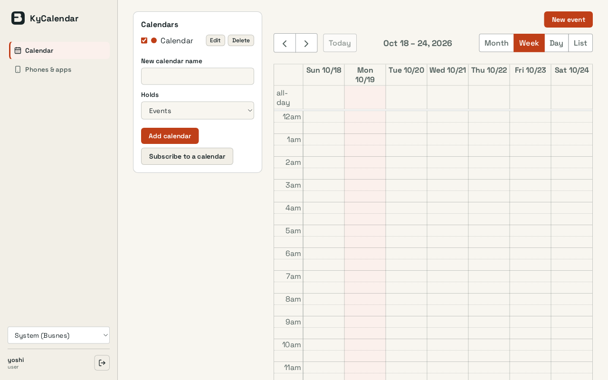
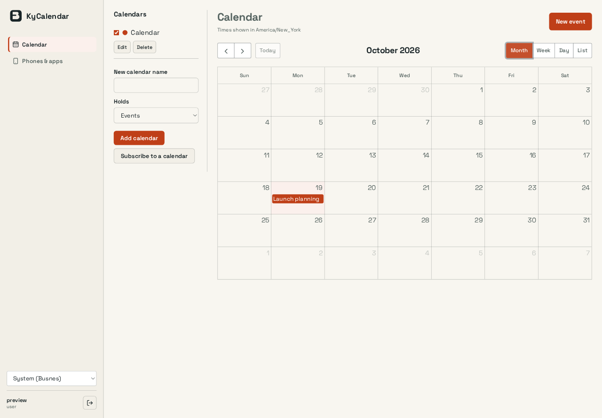
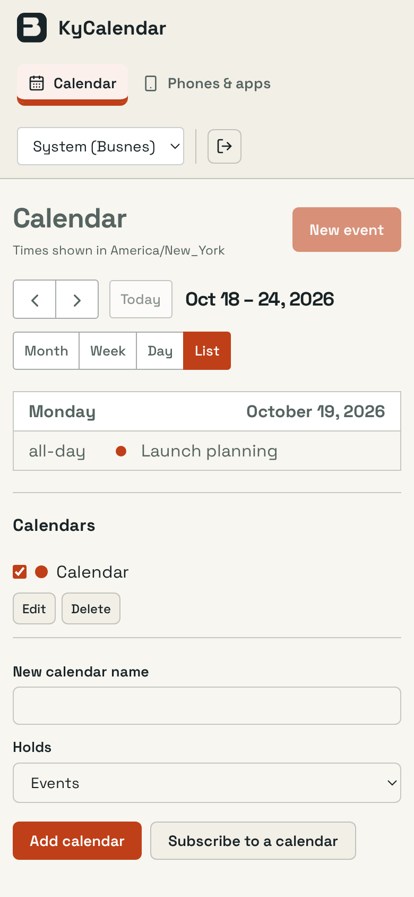
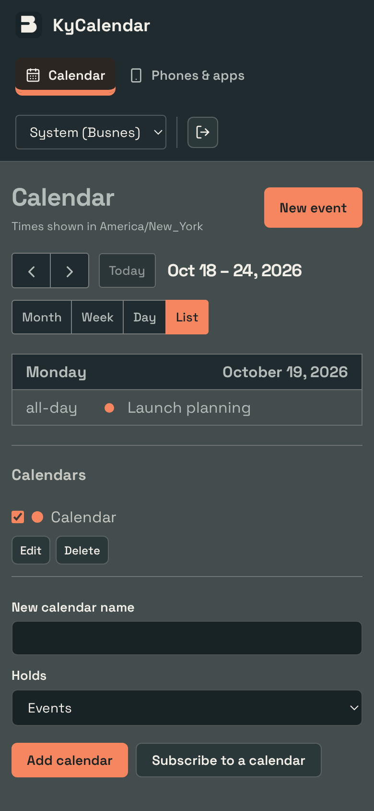

# KyCalendar interface polish

> Evidence scope: this document records the revision, environment and capture conditions below. Screenshots and generated fixtures demonstrate appearance; they do not qualify live email delivery, push delivery, recovery custody or every product feature. Test counts describe that recorded run, not the current suite.

KyCalendar now has more room for the calendar, grouped controls and a calendar-first phone layout. This implements the approved visual direction against the existing product; no mockup data or replacement application shell is shipped.

## Preserved

Month/week/day/list, calendar visibility preferences, events/recurrence/invitations, calendar/task types, subscriptions, app passwords and all admin settings.

No deployed configuration, accounts, credentials or stored content were changed. Authentication, API clients, persistence, backend logic, dependency manifests and migrations are unchanged. Product themes, palette choices and saved preference keys are retained; hash-pinned shared UI files are untouched. Existing React event-handler expressions were compared against the base revision and retained.

## Evidence

Captured 2026-10-19 from the built interface in T3's native browser, at 1440×1000 and 390×844 CSS pixels. PNG dimensions may be larger because of browser device scaling. The dark capture is a phone view. Capture conditions: Real disposable everyday account, required first-password change and an all-day event created through the form. Desktop capture uses Month; the phone loads the existing List-week default. Calendar management follows the canvas on narrow screens.

Before is the actual installation-campaign screenshot used for the approved proposal. After is this branch on disposable data. Their content differs; these images compare presentation, not a live-data migration.

| Before | Implemented desktop |
| --- | --- |
|  |  |

| Implemented phone | Implemented phone, dark |
| --- | --- |
|  |  |

## Checked

`npm test`: 137 tests passed. Production build passed. Chromium light/390: event create/list/keyboard/Escape/delete, group grants, people onboarding and CSP/worker/themes/responsive shell all passed (4 tests).

The inspected phone state had no document-width overflow. This is targeted interface verification, not an exhaustive accessibility or nine-product integration qualification. Repository-wide CI, container/PostgreSQL/real-runtime checks and autonomous review remain separate gates.

## Review

Review [web/src/pages/CalendarPage.tsx](web/src/pages/CalendarPage.tsx) for the product layout and preserved actions. Generated assets and screenshots can be skipped when reviewing behavior. Check the source layout and existing permission/confirmation boundaries before merging. No deployment or merge is included.
