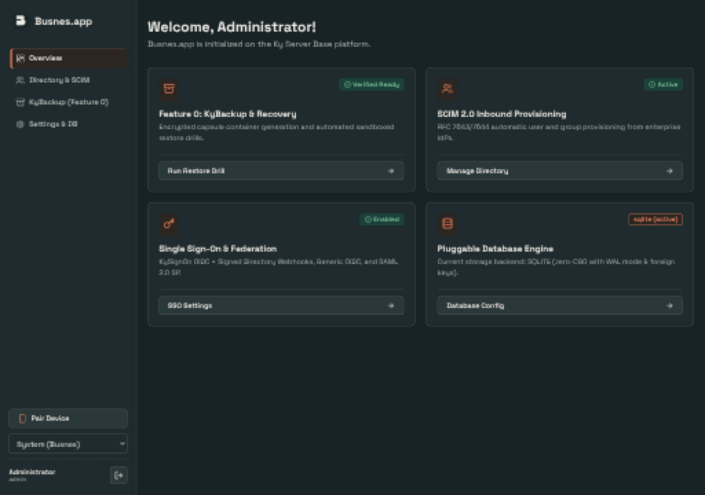
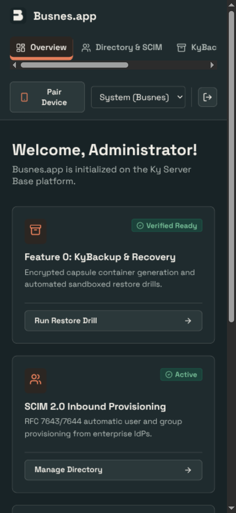

# Shared UI verification

> Evidence scope: this document records the revision, environment and capture conditions below. Screenshots and generated fixtures demonstrate appearance; they do not qualify live email delivery, push delivery, recovery custody or every product feature. Test counts describe that recorded run, not the current suite.

## Change

Include the base as a required consumer so future products inherit verified shared assets. Shared assets are pinned to ky-ui 0.2.0 with content hashes. Product layouts, saved theme keys and named presets remain local.

## Capture conditions

Captured 2026-09-25 from this branch, using the application UI (not a design mockup). Overview in a real scratch server using scaffold defaults.

OS-following Busnes Light and Dark were captured at 1280×900 and 390×844 CSS pixels. Browser device scaling may make PNG dimensions larger. Document width stayed within the viewport in these captured states; local navigation/table scrolling is intentional. Screenshots show the selected-page accent, not a complete accessibility audit.

The subsequent browser-regression change moves worker registration into the JS bundle; production CSP is unchanged. Activation now passes against the real server. HTML refreshes online, and caching excludes dynamic/auth routes.

## Checks

7 frontend tests and production build passed. Central ky-ui sync --check verified all ten consumers. Screenshot coverage is Busnes Light/Dark; existing named choices are retained, but not every named palette/page combination was visually exercised.

## Screenshots

| Light | Dark |
| --- | --- |
|  |  |
|  |  |

## Reproduce

### Automated regression coverage

`web/browser/ui.spec.mjs` runs against a freshly built Go server with disposable SQLite data, real login and production CSP at 390×900 and 1280×900 in both OS themes. CI retains screenshots and failure traces for seven days and requires the browser job before publishing.

The assertions cover worker activation and stale-shell refresh, invalid-login errors, theme persistence and cross-tab/OS transitions, Paper-to-Busnes switching, selected navigation/focus, Settings overflow, and the absence of the removed Pair Device entry point. The tests exposed and fixed the old 480px minimum Settings column. These are workflow checks, not all-page E2E or full accessibility coverage.

Representative capture from the automated run (2026-09-25; the server is deleted afterward):

| Mobile Settings — light |
| --- |
|  |

Build the frontend, then run `go build -o .browser/server ./cmd/server` from the repo root and `cd web && npx playwright install chromium && npm run test:browser`.

### Manual inspection

Run npm ci, npm test (where configured), and npm run build in web/, then start the product with isolated local preview data following its README. Use System theme, emulate OS light/dark, and inspect both viewport sizes. Do not point preview instances at production data. For KyVault, use a configured development KyIdentity or explicitly labeled read-only browser fixtures; never bypass backend authentication.

## Approved interface polish — 2026-10-19

See [UI-POLISH.md](UI-POLISH.md) for the implemented changes, preservation scope, checks, actual before/after screenshots and disposable capture conditions. Earlier captures above remain historical evidence.

## Launch beauty pass — 2026-10-21

Every page and dialog, before (main at `ff8496f`) and after, in Busnes Light and Dark at 1280×900 and 390×844 CSS pixels: [docs/screenshots/ui-pass/](docs/screenshots/ui-pass/). Each image is one page: the top row is before, the bottom row after; the first screen of each capture is shown.

Capture conditions: the built server on disposable SQLite data, fictional people (`lgtm.llc`: Alex Morgan, Sam Rivera, Jordan Lee) and events, a clock fixed at 2026-10-21 10:15 America/New_York, Chromium with `calendar.lgtm.llc` mapped to loopback inside the browser only. 1920×1080 captures were inspected but are not committed. Phone captures are full-page, so the sticky header can show a blank band above the page on both sides.

`npm test`, the production build and the Chromium suite (light/dark × 390/1280, including the new week-view and agent-setup overflow checks) passed on this revision. This is visual evidence, not a full accessibility audit.

## Agent access levels — 2026-10-21

The Phones & apps form and agent list, before (main at `f4ec94e`) and after, in Busnes Light and Dark at 1280×900 and 390×844 CSS pixels: [docs/screenshots/agent-access/agent-access-form.jpg](docs/screenshots/agent-access/agent-access-form.jpg). Top row before, bottom row after; each capture runs from the add card to the end of the list.

Capture conditions: the built server on disposable SQLite data, the fictional everyday user `sam.rivera` with four fictional devices and agents (one per access level), AI agent chosen in the form.

## Suite cohesion pass — 2026-10-26

Four staged changes toward the Ky suite design contract (shell; calendar views; forms and dialogs; one left column, replacing the separate calendar-list column) on ky-ui 0.3.0 tokens. Before and after captures for every stage, in Busnes Light and Dark at 1280×900 and 390×844 CSS pixels, with source hashes, fixture and capture conditions, are in the ky-ui council record `reviews/2026-10-26-council/kycalendar-implementation.md` (images `kycalendar-0{1,2,3,4}-{before,after}-*`). The baseline is `origin/main` at `9a527d2` with the ky-ui 0.3.0 vendor sync.

Capture conditions: the built server on disposable SQLite data, real sign-in per capture, the browser clock fixed at 2026-10-27 10:15 America/Chicago, fictional events. A Nord capture checks that saved named palettes reach the calendar. Stage 8 (runtime review F1) pairs hovered primary-navigation captures before and after the global primary-hover fix, at both sizes in both Busnes themes, with computed colours and contrast in each manifest (`kycalendar-08-{before,after}-nav-hover-*`). Stage 6 (review corrections) pairs before and after captures of Month, Subscribe, the landing view, the phone calendar disclosure, the New event dialog and the empty, loading (3s emulated network latency) and offline states, `kycalendar-06-{before,after}-*`. Stage 4 also records a draft-resize sequence (rename and subscribe drafts typed, the window crossing 720px and back, both starting widths) and enlarged date-field focus crops (field root ring; Chromium's own ring on the calendar-picker icon).

## Fleet Appearance picker — 2026-10-26

KyCalendar gained an Appearance page for both roles (Match system plus the 22-theme suite catalog as native radio cards, saved `ky_theme` IDs kept); the sidebar and admin Settings theme selects are gone. Staged before/after captures at 1280×900 and 390×844 in OS light and dark, with source patches, binary and asset hashes and per-file measurements, are in [docs/ui-fleet-2026-10-26/](docs/ui-fleet-2026-10-26/README.md) (`manifest.json`, `captures.csv`, `checks.csv`). They are scratch captures with synthetic data and carry no rating.

## App rail — 2026-10-31

The suite app rail (ky-ui 0.9.0) in the sidebar foot and, on phones, above the licence line, before (main at `0f83e33`) and after, in OS light and dark at 1440×900 and 390×844 CSS pixels: [docs/screenshots/app-rail/](docs/screenshots/app-rail/) (`before-*` and `after-*`).

Capture conditions: each build on disposable SQLite data, real sign-in as the local everyday user `walter`, production CSP (no violations; every mark loaded). A local account gets an empty list, so for the after captures the browser answered `GET /api/suite/apps` with six fictional apps (KyIdentity, KyPost, KyCalendar, KyDrive, KyNotes, KyMessages); the server side is covered by `internal/api/suite_apps_internal_test.go`. Exactly one rail was visible at each width. With six apps the desktop rail wraps to two rows and the calendar list's first row scrolls under the sidebar fade at 1440×900.
