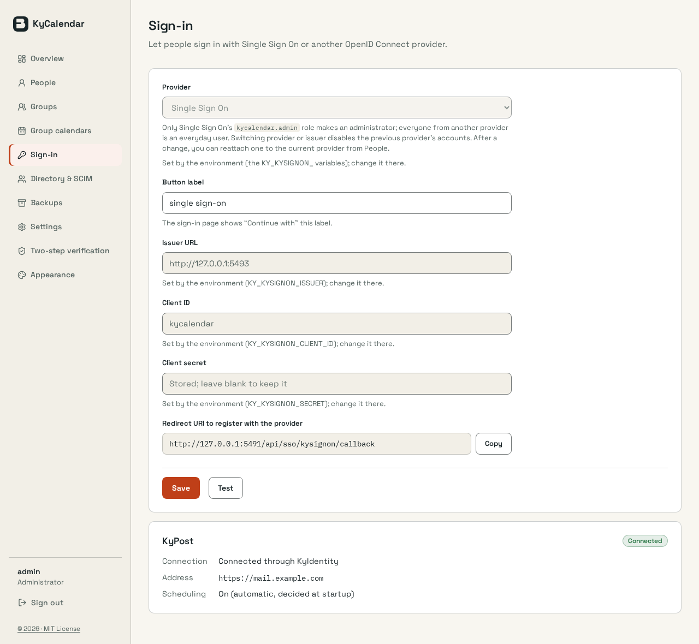
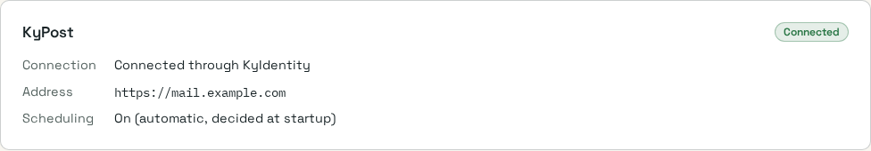

# KyPost pairing through KyIdentity: admin status

Captured 2026-10-31 from a locally built `cmd/server` (branch `feat/kyidentity-kypost-pairing`),
SQLite, light theme, Chromium 1280x1180. Sign-in came from `KY_KYSIGNON_*` pointing at a loopback
stand-in for KyIdentity that answered `GET /api/suite/peer?client=kypost` with
`https://mail.example.com` and a 32-byte secret. `KYCALENDAR_SCHEDULING` and
`KYCALENDAR_KYPOST_*` were unset, so scheduling was automatic. The startup log read
`[KYPOST] linked through KyIdentity: https://mail.example.com` then `[KYPOST] scheduling on
(KYCALENDAR_SCHEDULING=auto)`.

This is not the scheduling device gate (`2026-11-scheduling-device-gate.md`): no mail was sent.
